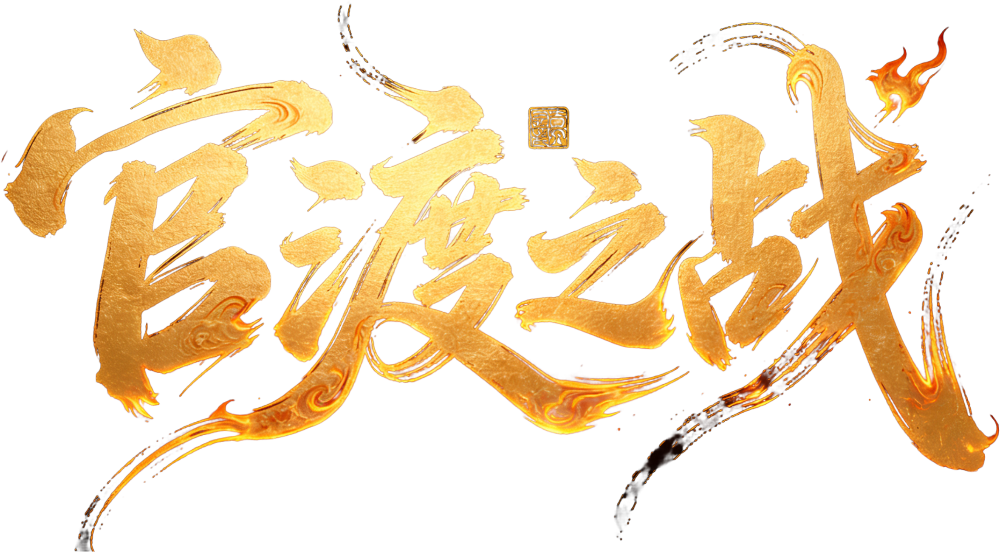
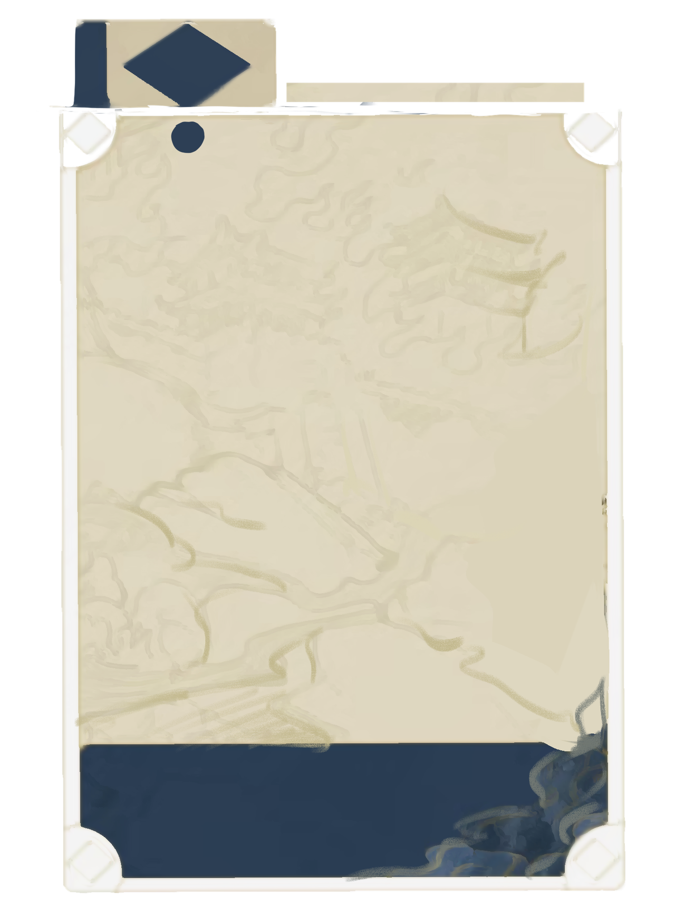

# 《三国·官渡之战》

> **尚未落定的胜负，由你亲手抉择。**
>
> 一款以东汉末年官渡之战为背景的 **2D 剧情解谜冒险游戏**。在这里，历史不只是一段等待阅读的故事，也是一场需要权衡信息、资源与风险的亲身决策。

  

  <strong>五幕剧情 · 四项战局资源 · 四类互动解谜 · 七种结局 · AI 史官 · 好友军议</strong>

**适合谁玩：** 喜欢三国历史、剧情选择、轻策略与解谜的玩家；希望通过互动方式接触中国历史文化的学生、老师和普通观众。作品以完整、可重玩的短篇战役为目标，建议首次体验预留约 15 分钟；实际时间会随探索和选择而变化。

**体验方式：** 支持 Windows 桌面游戏与 PC 浏览器 WebGL 版本。手机目前主要用于参加好友发起的“军议邀约”，不等同于完整游戏的移动端适配。

**[PC 网页体验入口（公网测试版）](http://81.70.40.146:8081/)**

> 网页入口依赖现有服务器，是否可访问以实际部署状态为准。建议使用新版 Chrome 或 Edge，在电脑上体验。AI 史官与手机军议需要网络及对应服务可用；网络不可用时，游戏主线仍可独立进行。

---

## 01｜作品简介：从历史的“结果”，走进决策的“过程”

公元 200 年，曹操与袁绍在官渡对峙。两军实力、粮草供给与战略处境各不相同，双方都无法仅凭一场正面交锋轻易决定胜负。以弱抗强、守还是退、信不信来投之人、何时出兵袭击粮道——这些决定共同塑造了官渡之战的走向。

《三国·官渡之战》的创作起点，是一个面向年轻玩家的剧情冒险游戏构想。随着团队对三国人物和官渡战役的研究，我们逐渐把创作重点从“复述一段历史”转向“让玩家理解历史人物为什么必须做选择”。

游戏采用**曹操视角**。玩家不是旁观者，而是曹军主将：每次决策既可能解决眼前困境，也可能消耗日后反击所需的兵力与粮草。游戏将史书记载的关键事件作为叙事参照，同时设计不同于历史走向的推演结局，让玩家通过多次游玩体会信息不全、资源紧张与判断失误带来的后果。

**我们的表达原则是：历史事实有依据，游戏演绎有边界，选择产生的结果有记录。** 游戏不是对史书的替代，也不把架空剧情当作真实历史。

## 02｜故事结构与玩法流程

故事围绕五幕展开。不同选择可能使战局提前结束，也可能带领玩家进入后续章节，因此并非每条路线都会经历所有剧情。

| 剧情篇章 | 核心处境 | 玩家需要思考的问题 |
| --- | --- | --- |
| 第一幕：两军对峙 | 袁军压境、曹军初战受挫 | 面对强敌，是正面应战还是另寻破局之法？ |
| 第二幕：官渡相持 | 战事拉长，粮草与士气承压 | 继续坚守的代价是否值得？ |
| 第三幕：许攸夜访 | 突如其来的情报影响局势 | 如何评估情报的可信度与时机？ |
| 第四幕：奇袭部署 | 兵力、路线和冒险成本需要重新权衡 | 有限的筹码该投入哪里？ |
| 第五幕：乌巢决断 | 战局迎来关键转折 | 之前积累的选择会导向怎样的结局？ |

游戏体验由 **阅读剧情、作出选择、完成互动、观察战况、回看结果** 组成。每个决策节点都承接此前已经发生的事件；故事发展和结果评价会受到玩家的行动影响。

### 四项资源，让取舍变得可感知

| 资源 | 游戏中的意义 | 需要权衡什么 |
| --- | --- | --- |
| **兵力** | 曹军可用于作战与守备的力量 | 一次冒进可能削弱后续防线 |
| **粮草** | 持续作战的基础 | 长期相持往往意味着持续消耗 |
| **计策** | 战术筹划与策略行动的余地 | 决策不只是靠兵多，也依赖谋略 |
| **风险** | 当前战局面临的不确定性与压力 | 眼前的收益可能伴随更高代价 |

四项资源会随玩家决策发生变化，并在界面中持续呈现。它们不是装饰性分数，而是与剧情条件、结局判定和最终战报相联系的游戏信息。

### 四类解谜，融入战役叙事

游戏在剧情中安排了**拼图复原、格子行军、地道探索与战术滑块**等轻量小游戏。玩家不只是读对白、点选项，还需要亲自完成与战役场景相呼应的操作。小游戏的结果能够影响资源或后续发展，使互动挑战服务于故事，而不是独立存在的小游戏合集。

### 七种结局，允许重新理解历史

游戏设有 **1 条以史实为参照的结局路线、6 条架空推演路线**，也包含需要特定条件才能发现的彩蛋内容。

这些结局并非在回答“历史本来还可以怎样发生”，而是让玩家看见：当某一个决策条件被改变，游戏中的局势会怎样变化。历史记载与创作假设在游戏中分开说明，不把虚构的分支包装成历史定论。

## 03｜独自做决定，也可以请朋友出谋划策

游戏既能独自完成，也设计了一种特别的参与方式：**军议邀约**。

当玩家面临关键抉择，可以把当前已经发生的战况、候选策略发送给朋友。朋友使用手机浏览器加入短期军议，选择自己支持的方案，并填写理由；这些建议会回到主玩家面前，由主玩家决定采纳还是拒绝。

这一设计有三个关键点：

- **信息共享有范围。** 受邀者看到的是当前战局与可选方案，而不是未来剧情的答案。
- **协作不夺走主导权。** 朋友可以建议，真正推动剧情的决定始终由主玩家作出。
- **讨论会留下痕迹。** 建议及采纳情况可以进入本局回顾和战绩记录，让一次共同讨论成为故事的一部分。

手机军议需要在线服务；如果网络不可用，游戏仍保留单人体验和本地参谋流程。它不是多人实时操纵同一个角色，也不要求玩家注册账号。

## 04｜“问史官”：让历史资料进入游玩现场

传统历史游戏往往把背景知识放在独立资料页里，玩家想弄清某个历史问题时，需要先离开剧情查找。《三国·官渡之战》在游戏内设置了可随时打开的 **AI 史官**，希望把“玩游戏”和“理解历史”连在一起。

玩家既可以点击当前章节推荐的问题，也可以自由输入，例如：

- “为什么曹操能够在官渡坚持这么久？”
- “许攸提供的情报为什么重要？”
- “史书对双方兵力有哪些不同记载？”
- “我这一局为什么会输？”
- “我的决定和历史上的做法有什么区别？”

史官的回答基于团队整理的历史资料、人物与战役说明，以及游戏已经记录的玩家经历。联网时可以通过 DeepSeek 等兼容的语言模型服务理解自然语言问题，结合相关资料组织回答；离线或服务不可用时提供本地史料信息与保守回退。

特别是涉及“**我这一局**”的问题，史官需要依据玩家实际经历过的节点、选择和结局，而不能用历史上曹操或袁绍的胜负来代替玩家自己的结果。对于存疑史料或缺少记录的情况，系统应说明依据边界，不把模型推测伪装成史实。

这里采用的是**史料检索、上下文理解与回答约束相结合的方式**，并未自行训练一个历史大模型。AI 回答仍可能存在误差，重要历史判断应以其列出的资料来源及专业研究为准。

## 05｜一局结束之后，故事仍有回声

游戏不仅关注玩家“选了什么”，也关注玩家能否理解“这些选择如何累积为结局”。

**剧情回顾** 按玩家真实经历整理已发生的重要片段，不提前揭露尚未到达的故事；**战役复盘** 可以沿着时间顺序查看关键决策、资源转折及互动事件；**战绩报告** 则汇总本局结局、游玩时间、决策次数、四项资源趋势，以及可追溯的决策倾向与好友建议。

战绩还能制作为一张**国风长图海报**：Windows 版本可保存为图片，浏览器版本支持下载 PNG。海报旨在把玩家的独特战局转化为可展示、可交流的个人作品，而不是简单的一张“通关成功”截图。

游戏提供本地存档、自动检查点、结局归档和途中退出保存。存档数据与设备或浏览器环境相关，目前不提供跨设备账号云存档；清理浏览器站点数据可能影响网页端的本地记录。

## 06｜作品设计理念与创新之处

**一、以“决策代价”讲述历史。** 我们没有直接把官渡之战改写为问答测验，而是用兵力、粮草、计策与风险建立可感知的权衡，让历史处境成为玩家真正需要面对的难题。

**二、以“史实与假设并置”引导历史思辨。** 玩家可以在架空分支里尝试不同决定，也可以通过史官注、人物介绍与资料来源了解真实记载。游戏鼓励提出问题，而不是用虚构结果覆盖历史。

**三、把朋友的意见变成互动叙事的一部分。** 军议邀约让传统单人剧情选择拥有了现实中的讨论过程；建议会被保存，玩家仍然拥有最后决定权。

**四、让战绩记录服务于理解，而不仅是展示。** 游戏记录已发生的事件，并把同一批事实用于剧情回顾、资源曲线、决策复盘与战绩海报。展示的内容来自玩家真实游玩过程，而非事先编造的统一战报。

**五、把 AI 放在有史料依据的位置。** AI 史官重视自然语言交流，但不应凭空补写史实或玩家经历。模型理解问题，资料与游戏记录提供事实依据，二者各司其职。

**六、面向短时完整体验进行整体设计。** 五幕短篇、分支结局、轻量解谜、随时可查的知识说明和可分享战报，适合课堂展示、比赛体验，也鼓励玩家在不同路线中重复探索。

这些创新主要体现在**玩法机制之间的组合、信息组织方式和具体交互实现**，并不意味着其中每一项基础技术均为团队首创。

## 07｜视觉风格与听觉设计

作品以历史题材的庄重感和互动游戏的可读性为共同目标，使用地图、古籍、卷轴、墨色底纹及金色装饰构成视觉语言。角色立绘和对话框承担叙事表现；资源图标、按钮状态、战场背景与音效则帮助玩家及时感受局势变化。

在关键事件中，游戏会结合剧情场景使用箭矢、兵刃、火焰、坍塌等声音与背景音乐；当局势紧张时，也通过音量层次、画面色调及轻量视觉反馈烘托战场氛围。

下列图片为仓库内的**游戏视觉素材示例**，不是完整游玩画面截图：

  
  

## 08｜技术路线：从一个决定，到一份可回看的战局

游戏主体使用 **Unity 2022.3.62f3c1 与 C#** 开发，交互界面使用 Unity UI 和 TextMeshPro；Windows 桌面端与 WebGL 浏览器端共享同一套主要玩法逻辑。在线军议和 AI 史官由可选的 **Node.js 服务**提供支持，网页文件可由 Nginx 在云服务器上发布。

整体实现思路如下：

~~~text
玩家进入官渡故事
      ↓
阅读剧情 → 作出选择 → 参与解谜
      ↓
兵力、粮草、计策与风险随行动变化
      ↓
剧情条件判断与分支推进
      ↓
保存已经发生的选择、事件和结局
      ├── 剧情回顾、战役复盘
      ├── 战绩分析、资源曲线与海报
      ├── 好友参谋建议的接收与采纳
      └── AI 史官对本局或史料的解释
~~~

| 技术方向 | 使用方式 | 对玩家的价值 |
| --- | --- | --- |
| 剧情与规则数据管理 | 将对白、分支、资源变化、条件和场景配置与程序逻辑分开维护 | 内容更容易迭代，分支之间更容易保持一致 |
| 统一战局记录 | 记录玩家已发生的选择、小游戏结果、资源变动和结局 | 复盘、战报与史官解释可以共享真实依据 |
| 动态界面与音画反馈 | 根据剧情和战局状态调整界面、音效与视觉表现 | 让资源压力与剧情情绪被玩家直接感知 |
| 网页版与桌面版兼容 | 针对浏览器输入、图片下载等差异进行适配 | 可在电脑浏览器试玩，也能制作桌面构建 |
| 远程军议服务 | 使用短期会话、二维码、手机网页和建议回传 | 让朋友不安装游戏也能参与决策讨论 |
| 历史资料辅助问答 | 使用整理过的资料库、语言模型理解和来源约束 | 在剧情里随时提出问题，并核对背景信息 |
| 本地保存与断网处理 | 核心玩法不依赖云端，在线能力异常时降级 | 网络不稳定时仍可继续单人剧情 |

项目坚持一个基本的技术原则：**网络与 AI 增加的是互动方式，不应成为能否把主线游戏玩完的前提。**

## 09｜团队的原创性贡献与协作方式

本项目不是对现成三国游戏玩法的直接移植。团队围绕官渡战役重新组织了一套以“选择—资源—结果—复盘”为核心的短篇互动结构，并实现与之配套的剧情、规则和用户界面。

团队的工作主要分为以下方向；这是按实际工作内容整理的协作模块，并不代表固定的人员数量或一人只负责一项工作。

| 协作方向 | 主要工作与贡献 |
| --- | --- |
| **游戏策划与系统设计** | 明确曹操视角、五幕节奏、四项资源、分支结局、小游戏作用及好友参谋机制；把历史处境转化为可操作的游戏规则 |
| **程序开发与交互实现** | 实现剧情跳转、资源结算、小游戏接入、存档、战绩复盘、网页适配、军议通信及 AI 史官的程序逻辑 |
| **历史研究与文案创作** | 组织官渡关键事件、人物资料、剧情对白和分支说明；编写与校订史官知识卡、示范问答及界面文案，区分史实和艺术演绎 |
| **美术设计与界面整合** | 确定国风视觉方向，设计或整理界面底板、按钮、宣传与展示素材，并将人物、场景和文字排版统一到游戏内 |
| **音效、测试与发布协作** | 选择并适配音乐和效果音，检查剧情节点播放效果；开展分支测试、浏览器兼容测试和云端部署，收集实际游玩反馈并持续修正 |

我们的原创贡献主要在于**整体游戏方案、分支叙事组织、交互机制、程序系统、资料整理与多部分功能的整合设计**。作品使用的历史人物和真实史事属于公共历史题材；部分字体、配乐、音效及视觉资源可能来自第三方或经二次制作，其权利归属和许可条件应分别核对，不能因纳入项目就视为团队原创。

## 10｜目标受众与作品价值

- **三国历史与传统文化爱好者：** 不止了解人物和事件，也能从不同选择中观察战局变化，并主动查证史料。
- **剧情游戏与轻策略玩家：** 在短篇故事里体验资源博弈、互动解谜和多路线探索。
- **中学、大学及文化教育场景：** 可将一次战局作为讨论材料，围绕信息判断、历史叙事和团队协商展开交流。
- **对游戏制作和人机交互感兴趣的开发者：** 可参考分支叙事、数据化战绩、跨设备协作和 AI 辅助知识解释的整合方式。

我们希望作品能够带来的，不只是“知道官渡之战发生了什么”，而是进一步追问：**处在当时的位置、面对当时的信息，为什么有人选择坚守，有人选择撤退，又为什么一次情报判断可能改变整个战局？**

## 11｜如何游玩与运行

### 方式一：PC 浏览器直接体验

使用电脑浏览器打开：[《三国·官渡之战》WebGL 测试入口](http://81.70.40.146:8081/)。

建议使用较新的 Chrome 或 Edge；首次加载需要下载游戏资源，速度取决于网络。浏览器版本不要求安装 Unity；部分功能（如存档、文件下载及中文输入）可能受到浏览器权限或环境设置影响。完整游戏目前以**电脑端体验**为主。

如果网页入口暂时无法访问，请以仓库中的源码或团队提供的本地构建为准；公网入口并不承诺永久在线。

### 方式二：Windows 桌面版本

使用团队提供的 Windows 构建包，**完整解压后**运行其中的游戏可执行文件。请保持程序文件和同包的游戏数据文件夹在一起，不要只复制可执行文件。独立剧情可离线进行；联网功能需要能够连接到对应服务。

> GitHub 仓库主要保存项目工程源码，并不代表仓库根目录直接包含可运行的 Windows 安装程序。

### 方式三：从源码运行

开发环境需要 **Unity Hub、Unity 2022.3.62f3c1**。计划导出网页版时，应为对应 Unity 版本安装 **WebGL Build Support**。

~~~bash
git clone https://github.com/Onesummer-D/ThreeKingdoms-Guandu.git
~~~

通过 Unity Hub 打开克隆后的项目文件夹，等待资源导入完成，再打开主场景：

**Assets / Scenes / Guanduuuu.unity**

在 Unity 中点击播放即可进行编辑器内测试；需要导出时，在 **File → Build Settings** 中选择 Windows 或 WebGL。网页版应通过本地网页服务或 Unity 的 **Build And Run** 测试，不建议直接双击构建目录里的 `index.html`。

工程包含可选的在线服务源码；部署在线军议和语言模型服务需要相应的服务器、网络配置及合法的 API 凭证，**不要将密钥提交到公开仓库**。不配置这些服务，也不影响主线单人剧情的基本运行。

### 主要开发技术

| 类别 | 技术 |
| --- | --- |
| 游戏引擎 | Unity 2022.3.62f3c1 |
| 游戏开发语言 | C# |
| 交互与文字渲染 | Unity UI、TextMeshPro |
| 剧情和规则维护 | ScriptableObject 与结构化游戏数据 |
| 可运行平台 | Windows 桌面版、PC 浏览器 WebGL 版 |
| 在线服务 | Node.js、HTTP 接口、手机浏览器页面 |
| AI 史官 | 本地历史资料库及兼容 DeepSeek 的在线语言模型接口 |
| 网页部署 | Ubuntu、Nginx |
| 协作与版本管理 | Git、GitHub |

## 12｜版本说明与后续方向

当前版本已经覆盖主线剧情、多分支结局、解谜、资源系统、存档、剧情回顾、战绩报告、海报导出、史官问答与好友军议的主要流程，并完成了 PC WebGL 适配工作。联网服务与浏览器表现仍需在不同设备和实际部署环境中持续验证。

后续我们希望继续完善：不同浏览器下的加载与存储体验、史官回答的史实准确性与自然表达、文案和视觉细节、音效层次，以及不同结局与中途退出时的稳定性。**手机完整游戏适配、长期在线房间和跨设备云存档不属于当前已经交付的功能。**

项目持续根据试玩反馈调整，欢迎提交具体问题（发生的章节、操作步骤、预期和实际表现）及改进建议。

## 13｜版权与资料说明

项目代码仓库采用 [MIT License](./LICENSE)。需要特别说明：**仓库中的第三方音乐、音效、字体、插图和其他非原创素材，其使用与再分发仍以原作者及对应授权为准**，不能简单视为全部适用 MIT 许可。

团队为部分音效整理了可核查的 CC0 来源，其他素材的授权信息也在持续补充。参赛、二次传播或改作前，请核对 [素材来源与授权记录](./Documentation/素材授权台账.md) 和 [已整理的音效来源](./Documentation/QA/CC0ImportedAudio.md)。

有关游戏史实的说明优先依据整理后的历史资料，并保留不同记载之间的差别。**架空剧情是互动创作，不是历史事实；AI 回答是辅助理解的工具，不替代原始史料。**

---

<strong>《三国·官渡之战》—— 一场可以亲自参与、反复推敲、回望历史的官渡之战。</strong>

